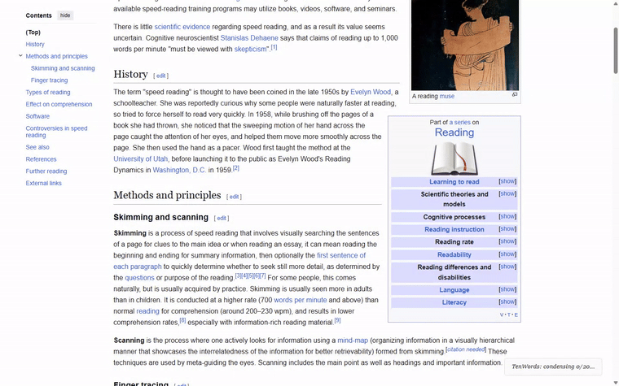

# TenWords

Every paragraph becomes exactly ten words. A local service + Chrome
extension + web page that condense verbose text (webpages, PDFs, docx,
txt) into 10-word-per-paragraph summaries with a 10-word TL;DR.

Site: https://tenwords.io · [Chrome Web Store](https://chromewebstore.google.com/detail/mhniadnpdakfejanehmhnabhakhhbcdl)

## Setup

1. `npm install`
2. Copy `.env.example` to `.env` and set `ANTHROPIC_API_KEY` (or pick another
   provider — see below).
3. `launch.cmd` (or `npm start`) — service runs on http://localhost:4710.
   If the service is already running, `launch.cmd` just opens the page.

**Set-and-forget:** run `install-autostart.cmd` once and the service
starts hidden at every Windows login — no console window, nothing to
remember. `uninstall-autostart.cmd` removes the autostart and stops the
service.

## Providers

TenWords calls one provider at a time. Set `PROVIDER` in `.env` and the key
for that provider; everything else has a default.

| `PROVIDER` | Key variable | Default model | Endpoint |
| --- | --- | --- | --- |
| `anthropic` (default) | `ANTHROPIC_API_KEY` | `claude-haiku-4-5-20251001` | api.anthropic.com |
| `openai` | `OPENAI_API_KEY` | `gpt-5-mini` | api.openai.com |
| `deepseek` | `DEEPSEEK_API_KEY` | `deepseek-chat` | api.deepseek.com |
| `kimi` | `MOONSHOT_API_KEY` | `kimi-k2-0905-preview` | api.moonshot.ai |
| `custom` | `PROVIDER_API_KEY` | none — set `MODEL` | your `BASE_URL` |

`MODEL` overrides the default model for any provider. `BASE_URL` applies to
`custom` only and points at any OpenAI-compatible endpoint (Ollama, vLLM,
OpenRouter, and the rest); `custom` needs both `BASE_URL` and `MODEL`. If the
key for the chosen provider is missing, the service refuses to start and names
the exact variable.

The ten-word enforcement is the same code for every provider. Only the request
shape differs: Anthropic gets `/messages` with `x-api-key`, everything else
gets `/chat/completions` with a bearer token.

The Chrome extension always talks to `http://localhost:4710` (hardcoded), so
the service must run on that port for the extension to work. `PORT` in `.env`
only changes the port for direct webapp/API use.

## What to expect

Documents are condensed in parallel batches of 40 paragraphs (up to 4
batches at once), and summaries stream in as each batch finishes — a
typical long article completes in 20-40 seconds and costs roughly a
tenth of a cent.

## Use it

**On any webpage:** load `extension/` unpacked via `chrome://extensions`
(Developer mode → Load unpacked). Then click the TenWords icon or press
**Alt+T** on any article. Press again (or "restore original") to undo.
To condense only part of a page, select the text and right-click →
**Condense selection**.

The extension has two modes. Out of the box it talks to the local
service, so `launch.cmd` must be running. Or open the extension's
options (right-click the icon → Options), pick a provider, and save its
API key: TenWords then calls that provider directly and needs no local
service at all. The same five presets are available (Anthropic, OpenAI,
DeepSeek, Kimi, or a custom OpenAI-compatible base URL), the model field
is editable, and a custom base URL asks Chrome for that one origin when
you save. The key stays in that browser profile
(`chrome.storage.local`) and is sent only to the provider you chose.

**On documents, URLs, and pasted text:** open http://localhost:4710 —
paste a URL, drop a PDF/docx/txt, or paste raw text (a long Claude or
ChatGPT answer, meeting notes, anything) into the text box and hit
Condense (Ctrl+Enter works too). The last 20 condenses are kept in a
Recent list (stored in this browser only) — click one to reopen it.

## How it works

Surfaces send paragraph blocks to `POST /summarize`; the service splits
them into batches of 40, runs up to 4 batched model calls in parallel,
counts every summary's words, retries offenders once (wrong count or a
sentence that trails off), and deterministically fixes anything still
wrong — you never see a line that isn't exactly ten words. For
multi-batch documents the TL;DR is written from the finished summaries
in one final call. `POST /extract` turns URLs (Readability) and files
(pdf-parse / mammoth) into blocks.

## API

`POST /summarize` — `{"blocks":[{"id":"p0","text":"..."}]}` →
`{"tldr":"...","summaries":[{"id":"p0","text":"..."}]}`

With `Accept: application/x-ndjson` the same endpoint streams progress
as NDJSON lines instead: `{"type":"batch","summaries":[...]}` per
finished batch, then `{"type":"tldr","tldr":"..."}`, then
`{"type":"done"}` (or `{"type":"error","error":"..."}`).

`POST /extract` — multipart `file` (pdf/docx/txt), `{"url":"..."}`, or
`{"text":"..."}` (raw pasted text, paragraphs split on blank lines) →
`{"blocks":[{"id":"p0","text":"..."}]}`

## Develop

- `npm test` — full suite (no API key needed; provider clients are mocked)
- Service code in `service/`, extension in `extension/`, webapp in `webapp/`
- `npm run sync-ext` — copies `service/words.js`, `service/summarizer.js`, and
  `service/providers.js` into `extension/lib/` so BYOK mode runs the exact same
  enforcement code; a test fails if the copies drift, so run it after editing
  any of those files
